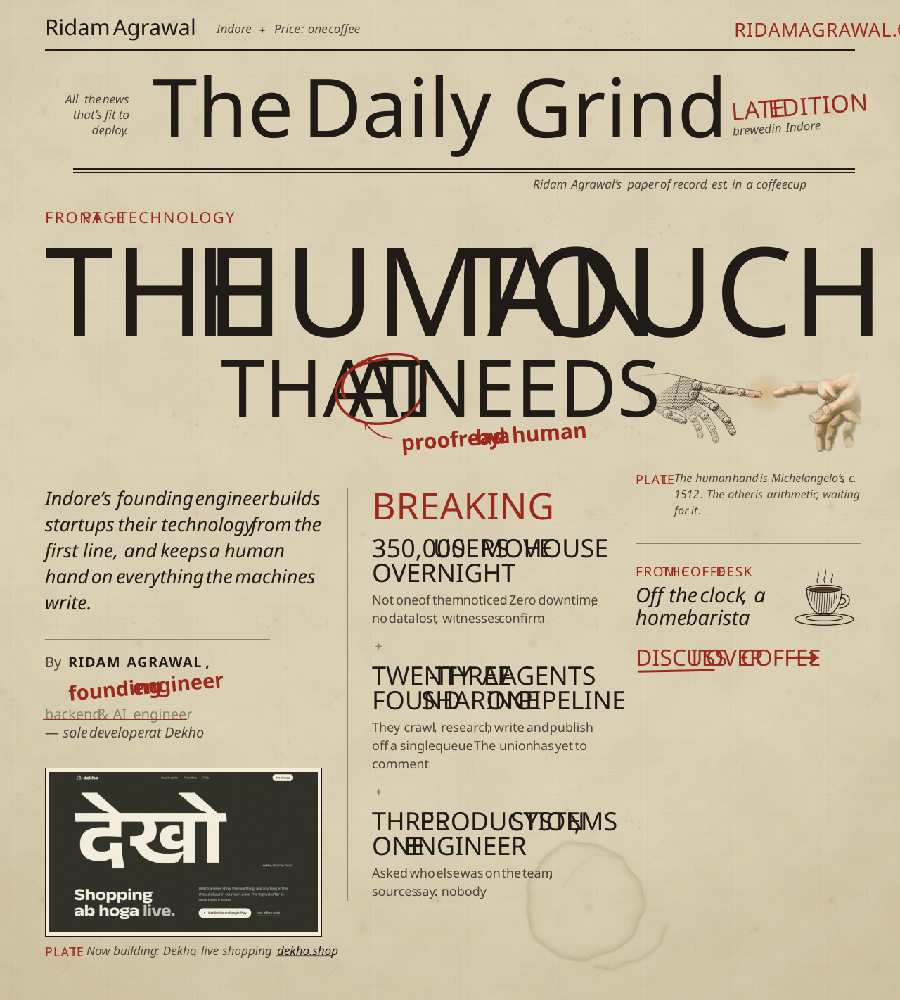
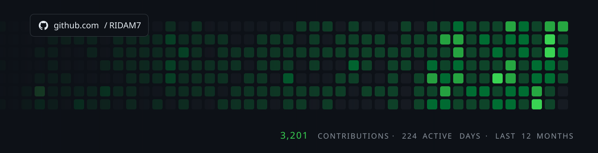
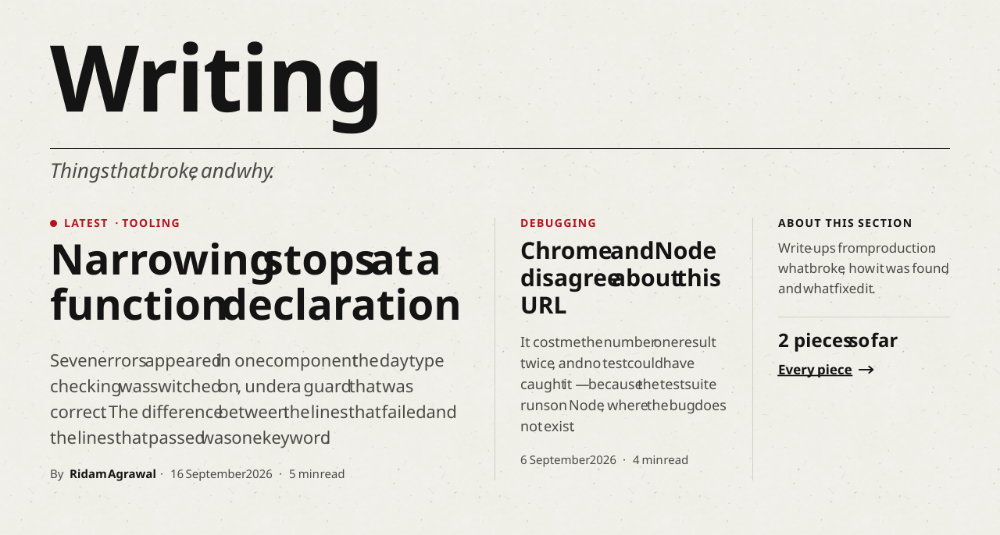

<!--
  Generated by render/render.mjs from render/data.json. Do not edit by hand.

  data.json is exported from ridamagrawal.com's own data files, so this page
  and the site cannot disagree. The contribution grid is fetched live, and a
  workflow re-renders it daily.
-->

Ridam Agrawal is a founding engineer in Indore and the sole developer at Dekho, a live-shopping app, working mostly on AI-powered products. Before Dekho: sole engineer on three production systems, a 23-agent multi-tenant SEO platform, the backend for a live broadcast competition app synced over WebSockets, and an internal operations suite.

<b><a href="https://ridamagrawal.com">ridamagrawal.com</a></b>&nbsp;&nbsp;·&nbsp;&nbsp;<a href="https://www.linkedin.com/in/ridam-agrawal-a5b6763ab/">LinkedIn</a>&nbsp;&nbsp;·&nbsp;&nbsp;<a href="https://x.com/RIDAM_N7">X</a>&nbsp;&nbsp;·&nbsp;&nbsp;<a href="mailto:ridam6419r@gmail.com">Email</a>&nbsp;&nbsp;·&nbsp;&nbsp;<a href="https://ridamagrawal.com/Ridam_Agrawal_Resume.pdf">Résumé</a>

<picture>
  <source media="(prefers-color-scheme: dark)" srcset="assets/head-experience-dark.svg">
  
</picture>

**Founding Engineer** · Dekho 
NOV 2026 — PRESENT · INDORE · FULL-TIME

- Founding engineer and sole developer of Dekho (dekho.shop), a live-shopping app on Android: sellers show the real thing live, and buyers ask anything and put in their own price.

**Software Developer** · MoonPhase Solutions 
MAR 2026 — OCT 2026 · INDORE · HYBRID · FULL-TIME

- Designed and built KeySignals (keysignals.tech), the company's AI platform for SEO and Generative Engine Optimization, end to end as the only engineer, owning frontend, backend and integrations. Now live.
- Architected a pipeline of 23 AI agents, coordinated by a queue-backed orchestrator on BullMQ and Redis, covering crawling, competitor and keyword research, clustering, content planning, writing, SEO and GEO optimization, and publishing.
- Routed Claude, OpenAI and Gemini per task on quality, latency and cost, grounding every page in a business profile drawn from the site's own pages rather than the model's memory.

6 more

- Built the GEO engine that tracks whether a brand is mentioned or cited in ChatGPT, Gemini, Perplexity, Google AI Overviews and AI Mode, plus a weekly Search Console and GA4 loop that drafts fixes for slipping pages and holds them for approval.
- Added off-site GEO tooling that finds Reddit threads and GitHub discussions in a brand's category through Google's index rather than scraping, and exposed a public API and an MCP server for external tools and AI agents.
- Built the control plane in Next.js 14: 67 dashboard screens on PostgreSQL, Redis and BullMQ, multi-tenant with NextAuth, JWT and role-based access control.
- Before KeySignals, built the backend for the official MasterChef platform (masterchefworld.app) from scratch as the sole backend developer, on Node.js, Express and MongoDB across 6 REST domains, 30 route modules and 68 data models.
- Engineered real-time event flow over WebSockets that keeps contestants in sync with a Twitch livestream despite per-viewer delay, and migrated 350,000+ existing users onto the new system with zero downtime and no data loss.
- Built a 41-screen React and TypeScript admin console, integrated AWS S3, SES, Mux and Firebase, and maintained the app alongside KeySignals.

**Freelance Full-Stack Developer** · Black Raven Esports 
JAN 2026 — FEB 2026 · REMOTE · FREELANCE

- Independently delivered a full-stack product for a 30,000+ member esports community, from architecture to deployment in two months.
- Discord and Google OAuth with JWT sessions, plus three core modules — teams, tournaments, scrims — with approval workflows, RBAC, audit logging and a ban system.

 

READ&nbsp;&nbsp;<a href="https://ridamagrawal.com/writing/narrowing-stops-at-a-function-declaration">Narrowing stops at a function declaration</a>&nbsp;&nbsp;·&nbsp;&nbsp;<a href="https://ridamagrawal.com/writing/chrome-and-node-disagree-about-this-url">Chrome and Node disagree about this URL</a>

